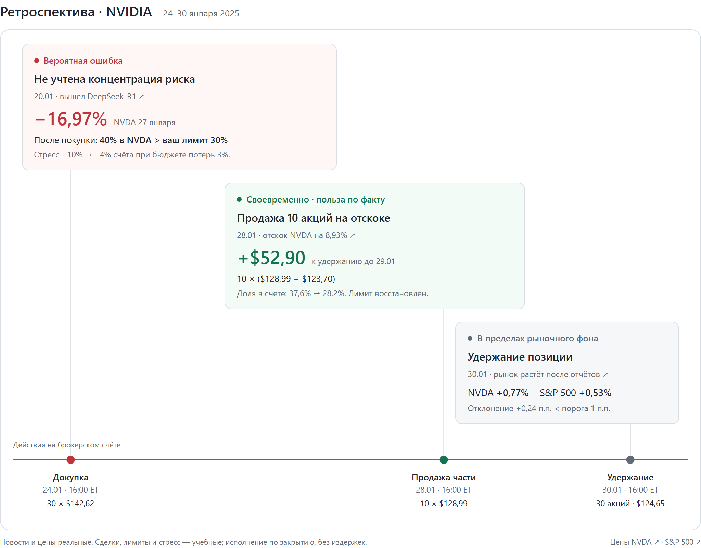

# TInvestIdea

ИИ-агент для ретроспективы инвестиционных решений: объясняет результат позиции и помогает проверить, соответствовали ли действия инвестора его исходной идее и правилам риска.

**Статус:** концепция проекта, примеры данных и исполняемый учебный расчёт. Интеграции с брокером и работающего ИИ-агента пока нет.

## Как работает

Инвестор выбирает бумагу и период. Система:

1. Восстанавливает операции и считает результат с учётом сплитов, дивидендов, комиссий и удержаний.
2. Сравнивает доходность бумаги с рынком и отраслью, выделяет необычные эпизоды.
3. Подбирает новости, опубликованные до движения, и показывает возможные объяснения со ссылками.
4. При наличии заранее записанных тезисов и правил проверяет их выполнение и сохраняет вывод для последующих разборов.

Математику и проверки выполняет код; LLM объясняет готовые результаты. **Убыток не доказывает ошибку решения, а прибыль — соблюдение правил.** Если контекста недостаточно, система сообщает об этом.

## Пример разбора



В иллюстрации используются реальные новости и цены NVIDIA; сделки и ограничения риска — учебные. [Источники и расчёты](docs/illustration.md).

## Данные

| Группа | Содержание | Пример |
|---|---|---|
| Новости | Публикации, раскрытия, время выхода, версии и источники | [01_news.json](examples/01_news.json) |
| Рынок | Котировки, индексы, инструменты и корпоративные действия | [02_market.json](examples/02_market.json) |
| Пользователь | Операции, остатки, запросы, тезисы и правила | [03_user_actions.json](examples/03_user_actions.json) |

JSON-набор синтетический. Полный порядок обработки описан в [схеме данных и пайплайне](docs/data-and-pipeline.md).

## Запуск учебного расчёта

```bash
python examples/build_demo.py
```

Нужен Python 3.10+ без сторонних библиотек. Скрипт создаёт пять JSON-файлов и проверяет баланс, P&L, связи источников и временные ограничения. Ожидаемый итог синтетической позиции: **−377,60 ₽**, остаток — **30 акций**. Поиск новостей и вызов LLM заменены эталонными примерами.

## План MVP

Подключение счёта через брокерский MCP в режиме чтения, рыночные данные ISS Мосбиржи, расчётное ядро, поиск источников и карточка разбора с чатом. Первый эксперимент — экспертная проверка объяснений относительно обычного поиска новостей по тикеру и дате.

Продукт предназначен для анализа прошлого опыта; прогнозы цен и торговые сигналы в MVP не входят.
